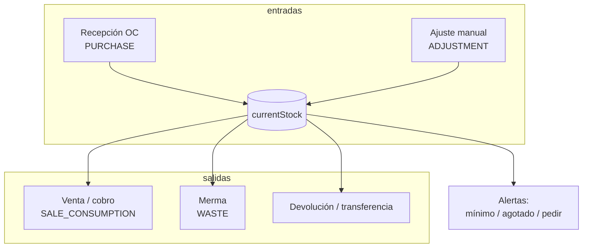
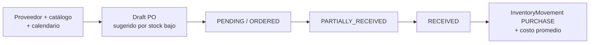

# The Pub Game Store Alena Sur — Mapa del sistema

Resumen de secciones de la app, campos de dominio, flujos operativos y controles de inventario.

**Marca / ticket**

| Campo | Valor |
|-------|--------|
| Nombre | The Pub Game Store Alena Sur |
| Dirección | León Guzmán 1615, 39, Nuevo Repueblo, 64700, Monterrey, Nuevo León, México |
| Teléfono | +52 871 153 4033 |
| Correo | contacto@thepubalenasur.com.mx |
| Sitio | thepubalenasur.com.mx |

---

## 1. Navegación (secciones UI)

Agrupadas como en el sidebar (visibles según RBAC):

### OPERACIÓN
| Sección | Ruta | Qué hace |
|---------|------|----------|
| Inicio | `/dashboard` | Hub por rol: caminos de trabajo + alertas relevantes |
| Mesas | `/pos` | Grid de mesas (filtros libre/ocupada/cobrar); abrir sesión; cobro |
| Órdenes | `/orders` | Listado de órdenes de restaurante abiertas |
| Cocina | `/kitchen` | Cola: enviado → preparando → listo |
| Cierre del día | `/daily-close` | Preview + cierre inmutable |

### CATÁLOGO
| Sección | Ruta | Qué hace |
|---------|------|----------|
| Menú | `/menu` | Categorías, productos, modificadores |
| Inventario | `/inventory` | Menú de tareas: stock, entrada, merma, producción, recetas |

### ABASTECIMIENTO
| Sección | Ruta | Qué hace |
|---------|------|----------|
| Pedidos a proveedor | `/purchases` | Órdenes de compra (PO) y recepción |
| Proveedores | `/suppliers` | Contacto, catálogo, calendario, lead time |

### CLIENTES
| Sección | Ruta | Qué hace |
|---------|------|----------|
| Clientes | `/customers` | Perfiles, visitas, lifetime spend |
| Promociones | `/promotions` | Códigos, vigencia, asignación a wallet |
| Reseñas | `/reviews` | Dashboard + generación de QR/token |

### EQUIPO
| Sección | Ruta | Qué hace |
|---------|------|----------|
| Empleados | `/employees` | Alta, perfil, horarios, compensación, ausencias |
| Asistencia | `/attendance` | Check-in/out, estados vs horario, correcciones |

### ADMINISTRACIÓN
| Sección | Ruta | Qué hace |
|---------|------|----------|
| Servicios y mantenimiento | `/services` | Servicios recurrentes + bitácora → gasto |
| Gastos | `/expenses` | Gastos operativos |
| Finanzas | `/finance` | Márgenes, COGS, inventario (solo ADMIN+) |
| Reportes | `/reports` | Resumen por rango de fechas |

### CONFIGURACIÓN
| Sección | Ruta | Qué hace |
|---------|------|----------|
| Configuración | `/settings` | Ajustes del sistema |

### Otras rutas
| Ruta | Uso |
|------|-----|
| `/login` | Acceso empleados |
| `/tickets/[checkId]` | Ticket imprimible (58/84 mm) |
| `/pos/tables/[tableId]` | Sesión de mesa (menú + cuenta) |
| `/inventory/[ingredientId]` | Detalle de insumo |
| `/employees/[id]` | Perfil de empleado |
| `/review/[token]` | Reseña pública (QR) |
| `/pedidos` | Alias / vista de pedidos |

---

## 2. Roles y permisos

### Roles (`RoleCode`)
`SUPER_ADMIN` · `ADMIN` · `MANAGER` · `WAITER` · `CASHIER` · `KITCHEN` · `KITCHEN_LEAD` · `KITCHEN_COOK` · `KITCHEN_ASSISTANT` · `INVENTORY`

### Caminos por rol (hub de Inicio)

| Persona | Home post-login | Caminos primarios |
|---------|-----------------|-------------------|
| Mesero | `/dashboard` | Mesas → enviar cocina · Órdenes · Asistencia |
| Caja | `/dashboard` | Cobrar (mesas) · Cierre del día · Gastos · Asistencia |
| Cocina | `/kitchen` | Cola · Recetas · Producción (si permiso) · Asistencia |
| Inventario | `/dashboard` | Entrada · Merma · Alertas · Pedidos a proveedor · Producción |
| Gerente / Admin | `/dashboard` | Mesas · Cocina · Inventario · Pedidos · (+ Finanzas admin) |

Nav: bloque **Tu camino** (primarios) + **Más** (resto de módulos con permiso).

### Recursos con permisos
`dashboard`, `pos`, `orders`, `menu`, `inventory`, `recipes`, `purchases`, `suppliers`, `customers`, `promotions`, `reviews`, `employees`, `finance`, `reports`, `settings`, `kitchen`, `payroll`, `expenses`, `checks`, `payments`, `daily_close`, `attendance`, `services`

### Acciones
`read` · `create` · `update` · `delete` · `close` · `adjust` · `apply`

### Cuentas demo (seed)
Contraseña común: `Password123!`

| Email | Rol |
|-------|-----|
| `superadmin@thepub.local` | SUPER_ADMIN |
| `admin@thepub.local` | ADMIN |
| `manager@thepub.local` | MANAGER |
| `waiter@thepub.local` | WAITER |
| `cashier@thepub.local` | CASHIER |
| `kitchen@thepub.local` | KITCHEN |
| `inventory@thepub.local` | INVENTORY |

---

## 3. Flujos principales

### 3.1 Flujo POS (mesa → cocina → cobro → ticket)

```mermaid
flowchart LR
  A[Mesa AVAILABLE] --> B[Abrir mesa<br/>partySize + mesero]
  B --> C[Order OPEN<br/>+ Seats + Check]
  C --> D[Agregar ítems<br/>modificadores / asiento]
  D --> E[Enviar a cocina]
  E --> F[Cocina: PREPARING → READY]
  F --> G[Cobrar Check<br/>CASH / CARD / TRANSFER]
  G --> H[Check CLOSED]
  H --> I[Consumo inventario<br/>SALE_CONSUMPTION]
  I --> J[Ticket / QR reseña]
  J --> K[Cerrar mesa<br/>si todas las cuentas pagadas]
```

**Estados de mesa (`TableStatus`):**  
`AVAILABLE` → `OCCUPIED` → `AWAITING_PAYMENT` → (pago) → `AVAILABLE`  
También: `RESERVED`, `CLEANING`

**Estados de orden / ítem (`OrderStatus`):**  
`OPEN` → `SENT_TO_KITCHEN` → `PREPARING` → `READY` → `DELIVERED` → `CLOSED`  
También: `CANCELLED`

**Estados de cuenta (`CheckStatus`):**  
`OPEN` · `CLOSED` · `CANCELLED`

**Controles en sesión de mesa**
- Cuentas múltiples + dividir (ítems / partes iguales / montos)
- Asignar productos a asientos (`Seat`)
- Enviar a cocina, cobrar, ver ticket
- Barra móvil fija: Cuenta · **Enviar a cocina** · **Cobrar**

**Ticket (impreso)**  
Nombre, dirección, teléfono, correo, web · ticket # · mesa · mesero · líneas · subtotal / descuentos / impuestos / TOTAL · método de pago.  
**Sin propina** en ticket ni en cobro (concepto aparte / legal).

---

### 3.2 Flujo inventario

**Regla clave:** el stock **nunca** se edita “en silencio”. Todo cambio genera `InventoryMovement` (y merma genera `WasteRecord`).

**Tipos de movimiento (`MovementType`):**  
`PURCHASE` · `SALE_CONSUMPTION` · `WASTE` · `ADJUSTMENT` · `RETURN` · `TRANSFER`

**Razones de merma (`WasteReason`):**  
`DAMAGED` · `EXPIRED` · `KITCHEN_ERROR` · `COMP` · `INTERNAL` · `OTHER`

**Unidades (`UnitType`):**  
`KG` · `G` · `L` · `ML` · `UNIT` · `BOX` · `PACK`

**Controles UI**
- Listado con estado vs mínimo / objetivo
- Detalle de insumo: entrada, merma, pedir
- Historial de movimientos (previo → resultante, costo, empleado)
- Receta producto ↔ insumos (`RecipeItem`) → consumo al cerrar cuenta

---

### 3.3 Flujo compras / proveedores

**Estados PO (`PurchaseOrderStatus`):**  
`DRAFT` · `PENDING` · `ORDERED` · `PARTIALLY_RECEIVED` · `RECEIVED` · `CANCELLED`

**Tabs proveedor:** Información · Productos · Calendario · Pedidos · `leadTimeDays`

---

### 3.4 Flujo cierre de día

1. Preview: ventas, efectivo/tarjeta/transferencia, descuentos, mermas, # órdenes  
2. Confirmación → `DailyClose` **inmutable** por `(locationId, businessDate)`

---

### 3.5 Flujo reseñas

1. Generar `ReviewToken` (desde reseñas o ticket)  
2. Cliente abre `/review/[token]`  
3. Guarda `Review` (overall + food/service/ambience opcionales)

---

### 3.6 Flujo servicios → gastos

1. Servicio recurrente (`Service`) con próxima fecha y recordatorio  
2. Bitácora `ServiceLog` (costo esperado/real)  
3. Opcional: crea/enlaza `Expense`

---

## 4. Campos por entidad (dominio)

### 4.1 Ubicación y usuarios
| Entidad | Campos principales |
|---------|-------------------|
| **Location** | name, address, phone, timezone, active |
| **User** | email, name, passwordHash, type (`EMPLOYEE`/`CUSTOMER`), active |
| **EmployeeProfile** | phone, hireDate, jobTitle, locationId, active |
| **CustomerProfile** | phone, visits, lifetimeSpend, lastVisitAt |
| **Role / Permission** | RoleCode + resource/action |

### 4.2 Menú
| Entidad | Campos principales |
|---------|-------------------|
| **MenuCategory** | name, description, imageUrl/Path, sortOrder, active |
| **MenuItem** | name, description, sku, price, estimatedCost, taxRate, available, requiresPrep, estimatedPrepMins, tags, active |
| **ModifierGroup** | name, required, minSelections, maxSelections, sortOrder |
| **ModifierOption** | name, priceDelta, active, sortOrder |
| **RecipeItem** | menuItemId, ingredientId, quantity, unit |

### 4.3 Inventario
| Entidad | Campos principales |
|---------|-------------------|
| **Ingredient** | name, category, baseUnit, currentStock, minimumStock, targetStock, averageCost, preferredSupplierId, active |
| **InventoryMovement** | quantity, movementType, referenceType/Id, previousStock, resultingStock, unitCost, notes, employeeId |
| **WasteRecord** | quantity, unit, reason, comment, employeeId, movementId |

### 4.4 Proveedores y OC
| Entidad | Campos principales |
|---------|-------------------|
| **Supplier** | name, contact, phone, whatsapp, email, notes, leadTimeDays, active |
| **SupplierProduct** | supplierSku, unit, unitCost, minOrderQty, active |
| **SupplierSchedule** | orderDay, deliveryDay (Weekday) |
| **PurchaseOrder** | status, orderedAt, expectedDelivery, receivedAt, notes |
| **PurchaseOrderItem** | quantityOrdered, quantityReceived, unit, expectedUnitCost, actualUnitCost |

### 4.5 POS / mesas
| Entidad | Campos principales |
|---------|-------------------|
| **RestaurantTable** | name, capacity, status, sortOrder, active |
| **Order** | tableId, waiterId, status, ticketNumber, partySize, openedAt/closedAt, notes, inventoryConsumedAt |
| **Seat** | label, displayName, sortOrder |
| **Check** | name, status, subtotal, discountTotal, taxTotal, tipTotal, total, customerId, promotionId |
| **OrderItem** | nameSnapshot, unitPrice, quantity, modifiersTotal, discountAmount, taxAmount, lineTotal, status, seatId, notes, sentToKitchenAt/readyAt/deliveredAt |
| **OrderItemModifier** | nameSnapshot, priceDeltaSnapshot |
| **Payment** | method (`CASH`/`CARD`/`TRANSFER`), amount, tipAmount*, reference, paidAt |

\* `tipAmount` existe en modelo; **no se usa en UI/ticket** (propina fuera de la cuenta).

### 4.6 Promociones y CRM
| Entidad | Campos principales |
|---------|-------------------|
| **Promotion** | name, code, type, amount, startsAt/endsAt, totalLimit, perCustomerLimit, stackable, appliesToEntireCheck |
| **PromotionType** | `PERCENTAGE` · `FIXED_AMOUNT` · `FREE_PRODUCT` · `SPECIAL_PRICE` |
| **CustomerPromotion** | assignedAt, expiresAt, used, usedAt |

### 4.7 Reseñas
| Entidad | Campos principales |
|---------|-------------------|
| **ReviewToken** | token, orderId, expiresAt, usedAt |
| **Review** | overallRating, foodRating, serviceRating, ambienceRating, comment, guestName, guestEmail |

### 4.8 Finanzas y ops
| Entidad | Campos principales |
|---------|-------------------|
| **Expense** | category, concept, amount, expenseDate, recurrence, supplierId, receiptUrl/Path, notes |
| **PayrollEntry** | periodStart/End, baseSalary, hours, bonuses, deductions, totalCost, status |
| **DailyClose** | businessDate, salesTotal, cashExpected, cardTotal, transferTotal, tipsTotal, discountsTotal, cancellationsTotal, wasteTotal, orderCount, notes |

### 4.9 Equipo
| Entidad | Campos principales |
|---------|-------------------|
| **EmployeeSchedule** | weekday, startTime, endTime, isDayOff |
| **EmployeeCompensation** | type (`MONTHLY`/`BIWEEKLY`/`WEEKLY`/`HOURLY`), amount, bonuses, tipsNotes, notes |
| **EmployeeAttendance** | checkInAt, checkOutAt, status, notes, openShiftKey (1 turno abierto) |
| **AttendanceStatus** | `ON_TIME` · `LATE` · `EARLY_LEAVE` · `COMPLETE` · `OPEN` · `ABSENT` |
| **EmployeeTimeOff** | type (`WEEKLY_OFF`/`ABSENCE`/`VACATION`/`PERMISSION`/`SICK`), date, notes |

### 4.10 Servicios
| Entidad | Campos principales |
|---------|-------------------|
| **Service** | name, category, supplierId, expectedCost, recurrenceType/Interval, last/nextServiceDate, reminderDaysBefore, status |
| **ServiceLog** | performedAt, expectedCost, actualCost, supplierName, expenseId, notes |

### 4.11 Auditoría
| Entidad | Campos |
|---------|--------|
| **AuditLog** | userId, action, entity, entityId, before/after (JSON), ipAddress, createdAt |

---

## 5. Tablas Prisma (índice)

| Dominio | Modelos |
|---------|---------|
| Auth | User, Account, Session, VerificationToken, Role, Permission, RolePermission, UserRole |
| Local | Location, EmployeeProfile, CustomerProfile |
| Menú | MenuCategory, MenuItem, ModifierGroup, ModifierOption, RecipeItem |
| Inventario | Ingredient, InventoryMovement, WasteRecord |
| Compras | Supplier, SupplierProduct, SupplierSchedule, PurchaseOrder, PurchaseOrderItem |
| POS | RestaurantTable, Order, Seat, Check, OrderItem, OrderItemModifier, Payment |
| CRM | Promotion, PromotionProduct, PromotionCategory, CustomerPromotion |
| Reseñas | ReviewToken, Review |
| Admin | Expense, PayrollEntry, DailyClose, Service, ServiceLog, AuditLog |
| RRHH | EmployeeSchedule, EmployeeCompensation, EmployeeAttendance, EmployeeTimeOff |

---

## 6. Controles de inventario (checklist operativo)

| Control | Dónde / cómo |
|---------|----------------|
| Stock mínimo / objetivo | `Ingredient.minimumStock` / `targetStock` |
| Alertas bajo / agotado | Dashboard + listado inventario |
| Pedido sugerido | Desde stock bajo → draft PO |
| Entrada de mercancía | Recepción PO → `PURCHASE` + avg cost |
| Salida por venta | Al cerrar cuenta → `SALE_CONSUMPTION` (receta) |
| Merma documentada | UI merma → `WasteRecord` + movimiento `WASTE` |
| Ajuste manual | Movimiento `ADJUSTMENT` con notas + empleado |
| Trazabilidad | `previousStock` / `resultingStock` + referencia |
| Costo | `averageCost` ponderado en compras; COGS en finanzas |
| Proveedor preferido | `Ingredient.preferredSupplierId` |

---

## 7. Stack técnico (referencia)

- **App:** Next.js App Router, TypeScript, Tailwind, shadcn/ui  
- **DB:** PostgreSQL (Neon) + Prisma  
- **Auth:** Auth.js (credenciales empleados; Resend opcional)  
- **Storage:** Vercel Blob (imágenes menú)  
- **Print:** `window.print` + CSS térmico (58 / 84 mm perfil)

---

*Documento generado a partir del esquema Prisma, navegación RBAC y módulos implementados en el repo.*
